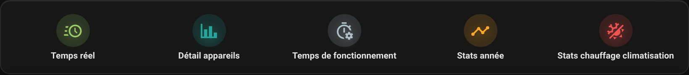
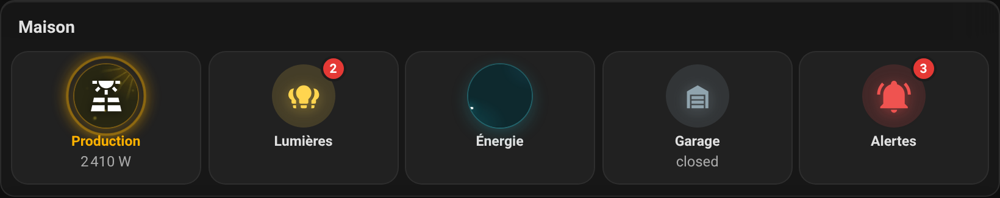
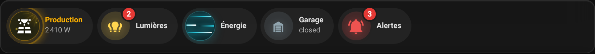
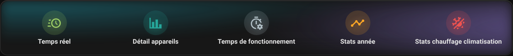
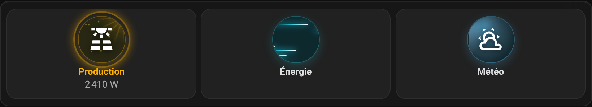
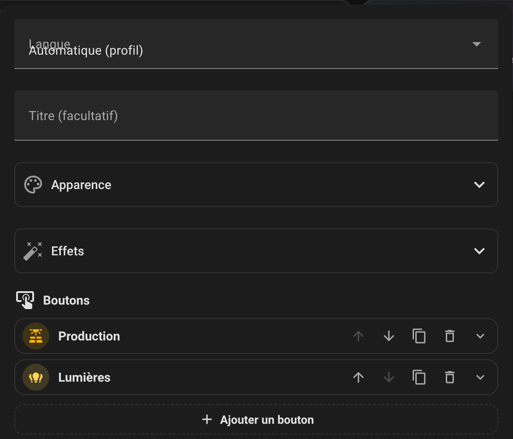
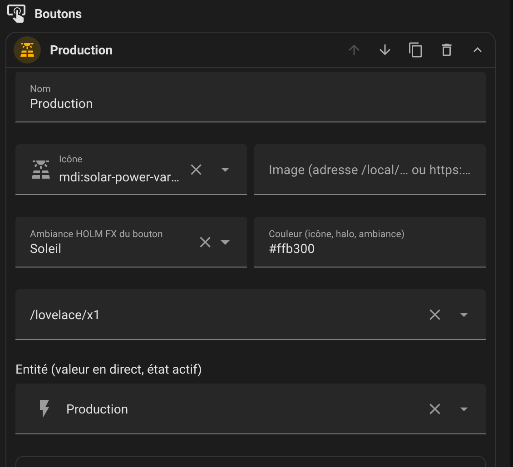

# ⚡ HOLM Shortcuts

[](https://hacs.xyz/)


[🇫🇷 Français](README.md) · 🇬🇧 English

**An animated shortcut bar for your Home Assistant dashboards: your pictures, icons or HOLM FX ambiences, live values and any action.**

HOLM Shortcuts puts a row (or a grid) of buttons in a view: "Real time", "Yearly stats", "Garage"… Each button can show **your own picture**, a coloured **icon** or an animated **[HOLM FX](https://github.com/kaaribou/holm-fx-card) ambience** (sun, energy, clouds…), show the **value of an entity** (2,410 W), **light up** when it is active and carry a **badge** (2 lights on). A tap opens a view or runs an action, a long press runs another one.

> ✨ **Zero YAML.** Add the card from the card picker, then create your buttons in the visual editor: name, picture (uploaded from the editor), icon, ambience, view to open, entity, badge, actions.



*Screenshots in French: the card follows the language of your Home Assistant profile.*

### At a glance

- 🖼️ **Your picture, an icon or a HOLM FX ambience** for each button, or both: the animated ambience goes behind the icon or picture.
- 📤 **Picture upload** from the editor, no need for the `www` folder.
- 🔢 **Live values** under the button (production, temperature…), **active state** (glowing ring) and a **different picture** when the entity is active (garage open / closed…).
- 🔴 **Badges**: number of lights on, windows open, a sensor value.
- 👆 **Actions**: open a view, more info, toggle an entity, run an action or a script, open an address; another action on long press.
- 🧭 **Current view** highlighted, like a navigation bar.
- 🎨 **Three button styles** (plain, tiles, pills), **three layouts** (row, grid, scrolling), **four sizes**, frosted-glass background and a **HOLM FX ambience behind the whole bar**.
- ✨ **Modern and lively**: cascading entrance, hover bounce, ripple on tap, vibration on mobile; everything can be turned off, and animations stop when the system asks for reduced motion.
- 📱 **Made for mobile**: labels that are too long shrink their font a little instead of being cut.
- 🌍 **8 languages**: French, English, German, Spanish, Italian, Dutch, Portuguese, Polish.

---

## Contents

- [Installation](#installation)
- [What the bar shows](#what-the-bar-shows)
- [Styles](#styles)
- [The visual editor](#the-visual-editor)
- [Card options](#card-options)
- [Button options](#button-options)
- [YAML example](#yaml-example)
- [FAQ](#faq)

---

## Installation

### With HACS (recommended)

1. HACS → ⋮ menu → **Custom repositories** → add `https://github.com/kaaribou/holm-shortcuts`, category **Dashboard**.
2. Search for **HOLM Shortcuts**, then **Download**.
3. Refresh your browser (Ctrl+F5).

### Manually

1. Copy `dist/holm-shortcuts-card.js` to `config/www/`.
2. **Settings → Dashboards → ⋮ → Resources** → add `/local/holm-shortcuts-card.js` (JavaScript module).
3. Refresh your browser.

### Animated ambiences (optional)

Ambiences come from the **[HOLM FX](https://github.com/kaaribou/holm-fx-card)** card, installed separately with HACS. Without it everything else works; the editor tells you so and ambiences are not shown.

---

## What the bar shows



| Element | Role |
|---|---|
| **Title** | Optional, above the buttons |
| **Visual** | Your picture, an icon in a circle tinted with the button colour, or a HOLM FX ambience in an animated circle (with the icon or picture on top if you set one) |
| **Label** | The button name, on 2 lines by default. If a word is too long for the button width (on mobile for instance), the font of the whole bar shrinks a little (down to 8 px) so it fits in full |
| **Value** | Under the label, the value of the button's entity, formatted by Home Assistant ("2,410 W", "Open"…); "Show the entity value" removes it |
| **Glowing ring** | The button is **active**: its entity is on, open, playing, armed… (or above / below the chosen threshold). The label takes the button colour |
| **Red badge** | The number of active entities among those chosen (2 lights on), or the positive value of a sensor (3 alerts). A **pulsing dot** if the badge entity is active without being a number |
| **Coloured background and line** | The current view: the button that opens the page shown is highlighted, with a small line below |
| **Ripple** | On tap, a ripple in the button colour starts from your finger; the picture or icon sinks then bounces |
| **Hover** (mouse) | The visual rises slightly and glows in the button colour; with tiles, the tile lifts |
| **Entrance** | When the view opens, buttons appear one after another |

**Tap**: the button action; by default the **view to open**, otherwise the entity details. **Long press** (½ second): the hold action; by default the entity details. In the mobile app, a light vibration confirms each press.

---

## Styles

**Plain** (default): the visual and the label, no frame, like a navigation bar. Above, with frosted glass.

**Tiles**: each button in its own rounded frame.

**Pills**: the icon on the left, the name and value on the right, in a pill. With the **Scrolling** layout, the bar slides under your finger on mobile.



**Bar ambience**: a HOLM FX ambience animates the whole bar background (here **Aurora**).



**Grid**: a fixed number of columns; here with tiles, **Extra large** size, and three ambiences (**Sun**, **Energy**, **Clouds**).



---

## The visual editor



| Element | Role |
|---|---|
| **Language** | Language of the card and editor; your profile's by default |
| **Title (optional)** | Title above the buttons |
| **Appearance** | Layout, columns, size, button style, labels, bar style, main colour, background, corner radius (see [Card options](#card-options)) |
| **Effects** | HOLM FX ambience of the bar and its intensity, hover and press effects, entrance animation, current view, haptic feedback |
| **Buttons** | The list of buttons with their visual and name. **↑ ↓** move them, **⧉** duplicates, **🗑** deletes, **⌄** opens the button settings (so does a tap on the name) |
| **Add a button** | Adds a button at the end of the list and opens it |

Button settings:



| Field | Role |
|---|---|
| **Name** | The button label |
| **Icon** | An mdi icon, with search |
| **Picture** | A `/local/images/my-button.png` (`www` folder) or `https://…` address |
| **Upload a picture** | Sends a picture from your computer or phone (like Home Assistant's Picture card) and fills the Picture field |
| **HOLM FX ambience of the button** | An animated ambience in the button circle; the icon or picture goes on top |
| **Colour** | Colour of the icon, circle, active ring, ripple and ambience (`#ffb300`, `orange`, `var(--accent-color)`…) |
| **View to open** | The view opened on tap (list of your dashboards' views) |
| **Entity** | For the value shown, the active state, and the details on long press |
| **Active when…** | **Show the entity value**; **Active states** (e.g. `open, opening`); **Active above / below** for a sensor (production > 500 W); **Picture when the entity is active** (garage open); **Animate the ambience only when the entity is active** (otherwise it stays calm) |
| **Badge** | Count active entities, or the value of an entity, and the badge colour |
| **Actions** | Tap and hold actions, with Home Assistant's action editor (view, more info, toggle, action, address…) |

---

## Card options

| Option | Values | Default | Description |
|---|---|---|---|
| `title` | text | — | Title above the buttons |
| `layout` | `row`, `grid`, `scroll` | `row` | In a row (equal width), grid, or scrolling (mobile) |
| `columns` | number | `4` | Grid columns |
| `size` | `s`, `m`, `l`, `xl` or a number of px | `m` | Visual size (30, 40, 52 or 64 px) and label size |
| `button_style` | `plain`, `tile`, `pill` | `plain` | Plain, tiles, pills (icon on the left) |
| `labels` | `below`, `hidden` | `below` | Labels under the button, or hidden |
| `label_lines` | number | `2` | Maximum label lines |
| `style` | `glass`, `card`, `transparent` | `glass` | Frosted glass, theme card background, or transparent |
| `accent` | colour | theme primary colour | Current view, and buttons without a colour |
| `background` | colour, gradient, `var(--…)` | — | Bar background |
| `border_radius` | `16px`, `16`… | theme's | Corner radius |
| `fx` | ambience name | — | HOLM FX ambience behind the whole bar |
| `fx_intensity` | 0.2 to 2 | `1` | Intensity of that ambience |
| `effects` | `true` / `false` | `true` | Hover, bounce and ripple on tap |
| `entrance` | `true` / `false` | `true` | Buttons appear one after another |
| `highlight` | `true` / `false` | `true` | Highlight the current view |
| `haptic` | `true` / `false` | `true` | Vibration on tap (mobile app) |
| `language` | `fr`, `en`, `de`, `es`, `it`, `nl`, `pt`, `pl` | profile's | Card language |
| `items` | list | — | The buttons (below) |

## Button options

| Option | Description |
|---|---|
| `name` | Label |
| `icon` | Icon (`mdi:…`) |
| `image` | Picture (`/local/…`, `https://…` or uploaded picture) |
| `image_on` | Picture when the entity is active |
| `fx` | HOLM FX ambience of the button |
| `fx_intensity` | Ambience intensity (0.2 to 2) |
| `fx_only_active` | Animate the ambience only when the entity is active |
| `color` | Button colour |
| `url` | View or address opened on tap (shortcut for `tap_action`) |
| `entity` | Entity: value, active state, details |
| `show_state` | `false` to hide the value |
| `active_state` | Active states, comma-separated |
| `above` / `below` | Active above / below a value |
| `badge` | `{ entities: [...] }` (number of active entities), or `{ entity: sensor.x }` (value), with `color` |
| `tap_action` / `hold_action` | Home Assistant actions: `navigate`, `more-info`, `toggle`, `perform-action`, `url`, `none` |
| `users` | (YAML) List of user names: the button only appears for them |

## YAML example

```yaml
type: custom:holm-shortcuts-card
button_style: tile
size: l
fx: aurore
items:
  - name: Production
    icon: mdi:solar-power-variant
    fx: soleil
    color: "#ffb300"
    entity: sensor.solar_production
    above: 500
    fx_only_active: true
    url: /lovelace/energy-now
  - name: Lights
    icon: mdi:lightbulb-group
    color: "#ffd54f"
    url: /lovelace/lights
    badge:
      entities: [light.living_room, light.kitchen, light.office]
  - name: Garage
    image: /local/images/buttons/garage_off.png
    image_on: /local/images/buttons/garage_on.png
    entity: cover.garage
    tap_action:
      action: toggle
  - name: Yearly stats
    image: /local/images/buttons/graph.png
    url: /lovelace/yearly-stats
```

---

## FAQ

**Ambiences don't show.** Install the [HOLM FX](https://github.com/kaaribou/holm-fx-card) card with HACS, then refresh the page.

**Picture upload fails.** It uses Home Assistant's **Image** integration (the one behind the Picture card), included in the default configuration. Without it, put your picture in the `www` folder and use `/local/…`.

**A label is cut.** Increase **Label lines**, choose a smaller size, or shorten the name.

**Fewer animations.** Untick **Hover and press effects** and **Entrance animation**; animations also stop by themselves if your device asks for reduced motion.

---

## Say thanks?

If you like HOLM Shortcuts, you can buy me a beer 🍺: [paypal.me/kaaribou](https://paypal.me/kaaribou)

## License

MIT — part of **HOLM** (Home Orchestration & Living Management).
