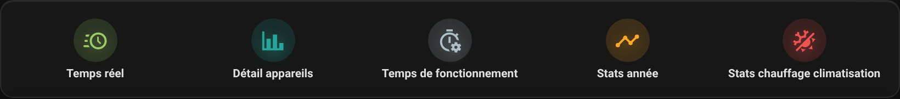
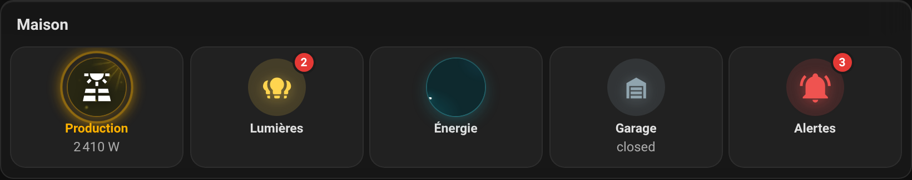
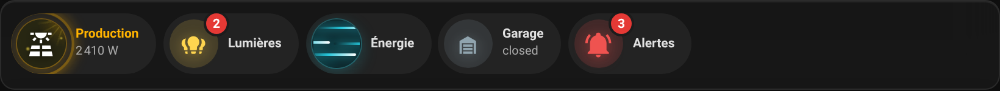
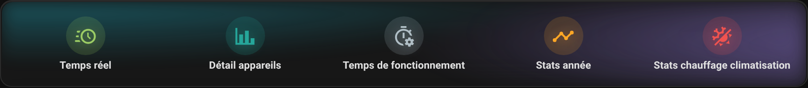
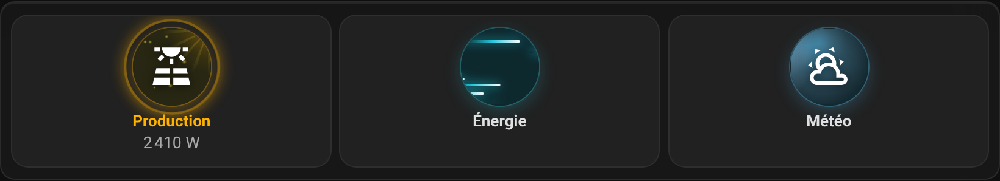
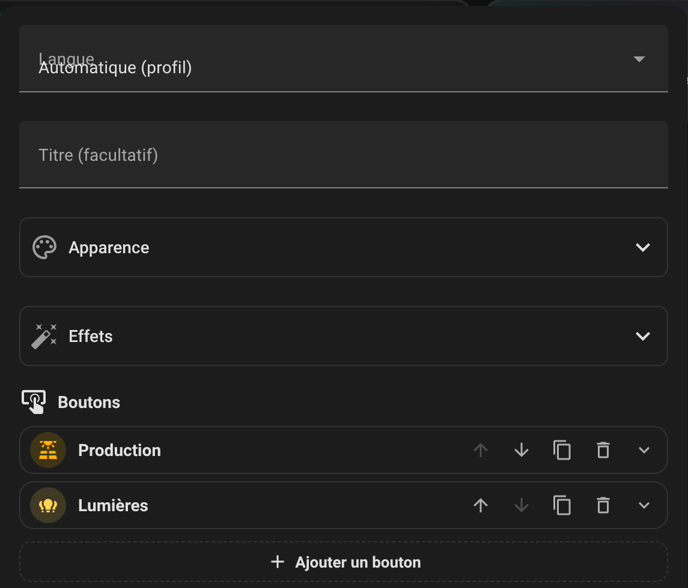
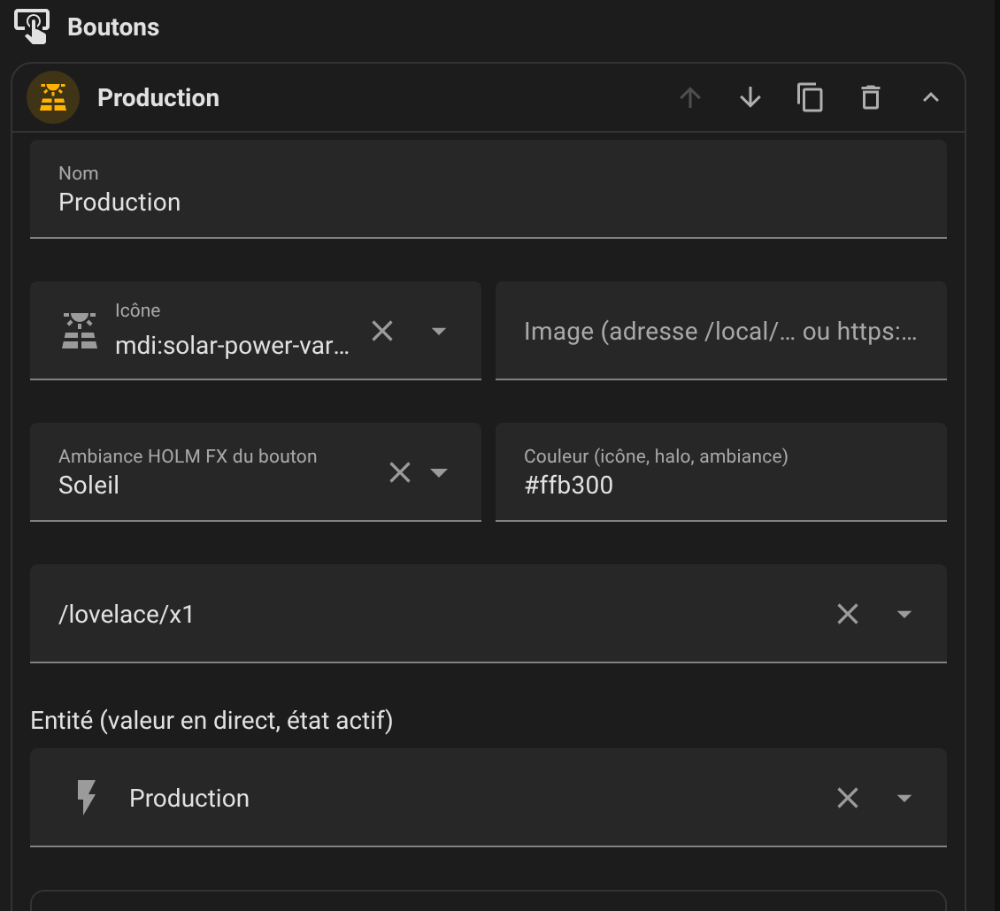

# ⚡ HOLM Shortcuts

[](https://hacs.xyz/)


🇫🇷 Français · [🇬🇧 English](README.en.md)

**Une barre de raccourcis animée pour vos tableaux de bord Home Assistant : vos images, des icônes ou des ambiances HOLM FX, des valeurs en direct et n'importe quelle action.**

HOLM Shortcuts pose dans une vue une rangée (ou une grille) de boutons : « Temps réel », « Stats année », « Garage »… Chaque bouton peut afficher **votre propre image**, une **icône** colorée ou une **ambiance animée [HOLM FX](https://github.com/kaaribou/holm-fx-card)** (soleil, énergie, nuages…), montrer la **valeur d'une entité** (2 410 W), s'**allumer** quand elle est active et porter une **pastille** (2 lumières allumées). Un toucher ouvre une vue ou lance une action, un appui long en lance une autre.

> ✨ **Zéro YAML.** On ajoute la carte depuis le sélecteur de cartes, puis on crée ses boutons dans l'éditeur visuel : nom, image (téléversée depuis l'éditeur), icône, ambiance, vue à ouvrir, entité, pastille, actions.



### En bref

- 🖼️ **Votre image, une icône ou une ambiance HOLM FX** pour chaque bouton, et même les deux : l'ambiance animée passe derrière l'icône ou l'image.
- 📤 **Téléversement d'image** depuis l'éditeur, sans passer par le dossier `www`.
- 🔢 **Valeurs en direct** sous le bouton (production, température…), **état actif** (anneau lumineux) et **image différente** quand l'entité est active (garage ouvert / fermé…).
- 🔴 **Pastilles** : nombre de lumières allumées, de fenêtres ouvertes, valeur d'un capteur.
- 👆 **Actions** : ouvrir une vue, plus d'infos, basculer une entité, lancer une action ou un script, ouvrir une adresse ; une autre action à l'appui long.
- 🧭 **Vue en cours** mise en évidence, comme une barre de navigation.
- 🎨 **Trois styles de boutons** (simple, tuiles, pastilles), **trois dispositions** (rangée, grille, défilante), **quatre tailles**, fond en verre dépoli et **ambiance HOLM FX derrière toute la barre**.
- ✨ **Moderne et vivante** : apparition en cascade, rebond au survol, onde au toucher, vibration sur mobile ; tout se désactive, et les animations s'arrêtent si le système demande moins de mouvements.
- 📱 **Pensée pour le mobile** : les libellés trop longs réduisent un peu leur police au lieu d'être coupés.
- 🌍 **8 langues** : français, anglais, allemand, espagnol, italien, néerlandais, portugais, polonais.

---

## Sommaire

- [Installation](#installation)
- [Ce que montre la barre](#ce-que-montre-la-barre)
- [Les styles](#les-styles)
- [L'éditeur visuel](#léditeur-visuel)
- [Options de la carte](#options-de-la-carte)
- [Options d'un bouton](#options-dun-bouton)
- [Exemple YAML](#exemple-yaml)
- [FAQ](#faq)

---

## Installation

### Avec HACS (recommandé)

1. HACS → menu ⋮ → **Dépôts personnalisés** → ajoutez `https://github.com/kaaribou/holm-shortcuts`, catégorie **Tableau de bord**.
2. Cherchez **HOLM Shortcuts**, puis **Télécharger**.
3. Rafraîchissez le navigateur (Ctrl+F5).

### Manuellement

1. Copiez `dist/holm-shortcuts-card.js` dans `config/www/`.
2. **Paramètres → Tableaux de bord → ⋮ → Ressources** → ajoutez `/local/holm-shortcuts-card.js` (module JavaScript).
3. Rafraîchissez le navigateur.

### Ambiances animées (facultatif)

Les ambiances viennent de la carte **[HOLM FX](https://github.com/kaaribou/holm-fx-card)**, qui s'installe à part avec HACS. Sans elle, tout le reste fonctionne ; l'éditeur vous le signale et les ambiances ne s'affichent pas.

---

## Ce que montre la barre



| Élément | Rôle |
|---|---|
| **Titre** | Facultatif, au-dessus des boutons |
| **Visuel** | Votre image, une icône dans un rond teinté de la couleur du bouton, ou une ambiance HOLM FX dans un rond animé (avec l'icône ou l'image par-dessus si vous en mettez une) |
| **Libellé** | Le nom du bouton, sur 2 lignes par défaut. Si un mot est trop long pour la largeur du bouton (sur mobile par exemple), la police de toute la barre se réduit un peu (jusqu'à 8 px) pour qu'il tienne en entier |
| **Valeur** | Sous le libellé, la valeur de l'entité du bouton, formatée par Home Assistant (« 2 410 W », « Ouvert »…) ; « Afficher la valeur de l'entité » la retire |
| **Anneau lumineux** | Le bouton est **actif** : son entité est allumée, ouverte, en lecture, armée… (ou au-dessus / en dessous du seuil choisi). Le libellé prend la couleur du bouton |
| **Pastille rouge** | Le nombre d'entités actives parmi celles choisies (2 lumières allumées), ou la valeur positive d'un capteur (3 alertes). Un **point pulsant** si l'entité de la pastille est active sans être un nombre |
| **Fond coloré et trait** | La vue en cours : le bouton qui ouvre la page affichée est mis en évidence, avec un petit trait en dessous |
| **Onde** | Au toucher, une onde de la couleur du bouton part du doigt ; l'image ou l'icône s'enfonce puis rebondit |
| **Survol** (souris) | Le visuel monte légèrement et brille de la couleur du bouton ; en tuiles, la tuile se soulève |
| **Apparition** | À l'ouverture de la vue, les boutons apparaissent l'un après l'autre |

**Toucher** : l'action du bouton ; par défaut, la **vue à ouvrir**, sinon les détails de l'entité. **Appui long** (½ seconde) : l'action à l'appui long ; par défaut, les détails de l'entité. Sur l'application mobile, une légère vibration confirme chaque appui.

---

## Les styles

**Simple** (par défaut) : le visuel et le libellé, sans cadre, comme une barre de navigation. Ci-dessus, en verre dépoli.

**Tuiles** : chaque bouton dans son propre cadre arrondi.

**Pastilles** : l'icône à gauche, le nom et la valeur à droite, dans une pilule. Avec la disposition **Défilante**, la barre glisse du doigt sur mobile.



**Ambiance de la barre** : une ambiance HOLM FX anime tout le fond de la barre (ici **Aurore**).



**Grille** : un nombre de colonnes fixe ; ici en tuiles, taille **Très grande**, avec trois ambiances (**Soleil**, **Énergie**, **Nuages**).



---

## L'éditeur visuel



| Élément | Rôle |
|---|---|
| **Langue** | Langue de la carte et de l'éditeur ; par défaut celle de votre profil |
| **Titre (facultatif)** | Titre au-dessus des boutons |
| **Apparence** | Disposition, colonnes, taille, style des boutons, libellés, style de la barre, couleur principale, fond, arrondi (voir [Options de la carte](#options-de-la-carte)) |
| **Effets** | Ambiance HOLM FX de la barre et son intensité, effets au survol et à l'appui, animation d'apparition, vue en cours, vibration |
| **Boutons** | La liste des boutons, avec leur visuel et leur nom. **↑ ↓** les déplacent, **⧉** duplique, **🗑** supprime, **⌄** ouvre le réglage du bouton (un toucher sur le nom aussi) |
| **Ajouter un bouton** | Ajoute un bouton à la fin de la liste et l'ouvre |

Le réglage d'un bouton :



| Champ | Rôle |
|---|---|
| **Nom** | Le libellé du bouton |
| **Icône** | Une icône mdi, avec recherche |
| **Image** | Une adresse `/local/images/mon-bouton.png` (dossier `www`) ou `https://…` |
| **Téléverser une image** | Envoie une image depuis votre ordinateur ou votre téléphone (comme la carte Image de Home Assistant) et remplit le champ Image |
| **Ambiance HOLM FX du bouton** | Une ambiance animée dans le rond du bouton ; l'icône ou l'image passe par-dessus |
| **Couleur** | Couleur de l'icône, du rond, de l'anneau actif, de l'onde et de l'ambiance (`#ffb300`, `orange`, `var(--accent-color)`…) |
| **Vue à ouvrir** | La vue ouverte au toucher (liste des vues de vos tableaux de bord) |
| **Entité** | Pour la valeur affichée, l'état actif, et les détails à l'appui long |
| **Actif quand…** | **Afficher la valeur de l'entité** ; **États actifs** (par exemple `open, opening`) ; **Actif au-dessus de / en dessous de** pour un capteur (production > 500 W) ; **Image quand l'entité est active** (garage ouvert) ; **Animer l'ambiance seulement quand l'entité est active** (sinon elle reste calme) |
| **Pastille** | Compter les entités actives, ou la valeur d'une entité, et la couleur de la pastille |
| **Actions** | Action au toucher et à l'appui long, avec l'éditeur d'actions de Home Assistant (vue, plus d'infos, basculer, action, adresse…) |

---

## Options de la carte

| Option | Valeurs | Par défaut | Description |
|---|---|---|---|
| `title` | texte | — | Titre au-dessus des boutons |
| `layout` | `row`, `grid`, `scroll` | `row` | En rangée (largeur égale), en grille, ou défilante (mobile) |
| `columns` | nombre | `4` | Colonnes de la grille |
| `size` | `s`, `m`, `l`, `xl` ou un nombre de px | `m` | Taille du visuel (30, 40, 52 ou 64 px) et des libellés |
| `button_style` | `plain`, `tile`, `pill` | `plain` | Simple, tuiles, pastilles (icône à gauche) |
| `labels` | `below`, `hidden` | `below` | Libellés sous le bouton, ou masqués |
| `label_lines` | nombre | `2` | Lignes de libellé au maximum |
| `style` | `glass`, `card`, `transparent` | `glass` | Verre dépoli, fond de carte du thème, ou transparent |
| `accent` | couleur | couleur principale du thème | Vue en cours, et boutons sans couleur |
| `background` | couleur, dégradé, `var(--…)` | — | Fond de la barre |
| `border_radius` | `16px`, `16`… | celui du thème | Arrondi des bords |
| `fx` | nom d'ambiance | — | Ambiance HOLM FX derrière toute la barre |
| `fx_intensity` | 0,2 à 2 | `1` | Intensité de cette ambiance |
| `effects` | `true` / `false` | `true` | Survol, rebond et onde au toucher |
| `entrance` | `true` / `false` | `true` | Apparition des boutons l'un après l'autre |
| `highlight` | `true` / `false` | `true` | Mettre en évidence la vue en cours |
| `haptic` | `true` / `false` | `true` | Vibration au toucher (application mobile) |
| `language` | `fr`, `en`, `de`, `es`, `it`, `nl`, `pt`, `pl` | celle du profil | Langue de la carte |
| `items` | liste | — | Les boutons (ci-dessous) |

## Options d'un bouton

| Option | Description |
|---|---|
| `name` | Libellé |
| `icon` | Icône (`mdi:…`) |
| `image` | Image (`/local/…`, `https://…` ou image téléversée) |
| `image_on` | Image quand l'entité est active |
| `fx` | Ambiance HOLM FX du bouton |
| `fx_intensity` | Intensité de l'ambiance (0,2 à 2) |
| `fx_only_active` | Animer l'ambiance seulement quand l'entité est active |
| `color` | Couleur du bouton |
| `url` | Vue ou adresse à ouvrir au toucher (raccourci de `tap_action`) |
| `entity` | Entité : valeur, état actif, détails |
| `show_state` | `false` pour ne pas afficher la valeur |
| `active_state` | États actifs, séparés par des virgules |
| `above` / `below` | Actif au-dessus / en dessous d'une valeur |
| `badge` | `{ entities: [...] }` (nombre d'entités actives), ou `{ entity: sensor.x }` (valeur), avec `color` |
| `tap_action` / `hold_action` | Actions Home Assistant : `navigate`, `more-info`, `toggle`, `perform-action`, `url`, `none` |
| `users` | (YAML) Liste de noms d'utilisateurs : le bouton n'apparaît que pour eux |

## Exemple YAML

```yaml
type: custom:holm-shortcuts-card
button_style: tile
size: l
fx: aurore
items:
  - name: Production
    icon: mdi:solar-power-variant
    fx: soleil
    color: "#ffb300"
    entity: sensor.production_solaire
    above: 500
    fx_only_active: true
    url: /lovelace/energietempsreel
  - name: Lumières
    icon: mdi:lightbulb-group
    color: "#ffd54f"
    url: /lovelace/lumieres
    badge:
      entities: [light.salon, light.cuisine, light.bureau]
  - name: Garage
    image: /local/images/buttons/garage_off.png
    image_on: /local/images/buttons/garage_on.png
    entity: cover.garage
    tap_action:
      action: toggle
  - name: Stats année
    image: /local/images/buttons/graph.png
    url: /lovelace/stat-production
```

---

## FAQ

**Les ambiances ne s'affichent pas.** Installez la carte [HOLM FX](https://github.com/kaaribou/holm-fx-card) avec HACS, puis rafraîchissez la page.

**Le téléversement d'image échoue.** Il utilise l'intégration **Image** de Home Assistant (celle de la carte Image), comprise dans la configuration par défaut. Sans elle, mettez votre image dans le dossier `www` et indiquez `/local/…`.

**Un libellé est coupé.** Augmentez **Lignes de libellé**, choisissez une taille plus petite, ou raccourcissez le nom.

**Moins d'animations.** Décochez **Effets au survol et à l'appui** et **Animation d'apparition** ; les animations s'arrêtent aussi d'elles-mêmes si votre appareil demande de réduire les mouvements.

---

## Un petit merci ?

Si HOLM Shortcuts vous plaît, vous pouvez m'offrir une bière 🍺 : [paypal.me/kaaribou](https://paypal.me/kaaribou)

## Licence

MIT — fait partie de **HOLM** (Home Orchestration & Living Management).
